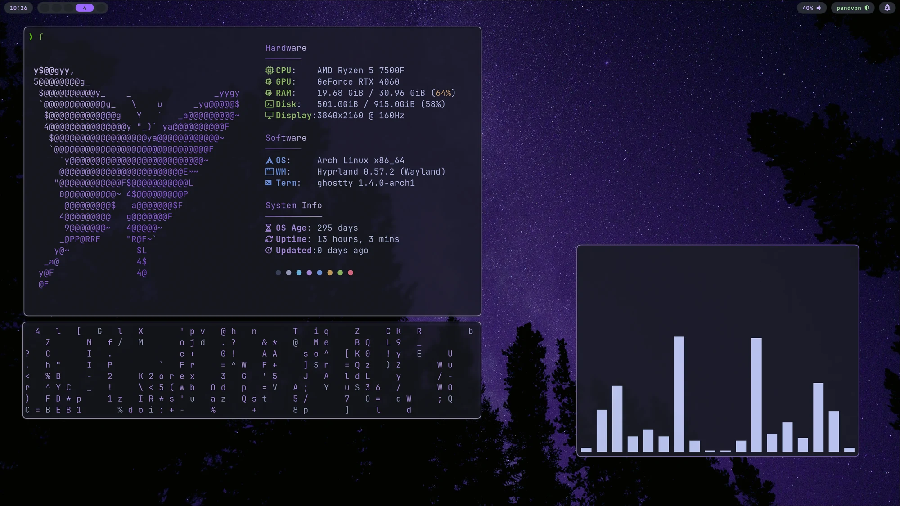
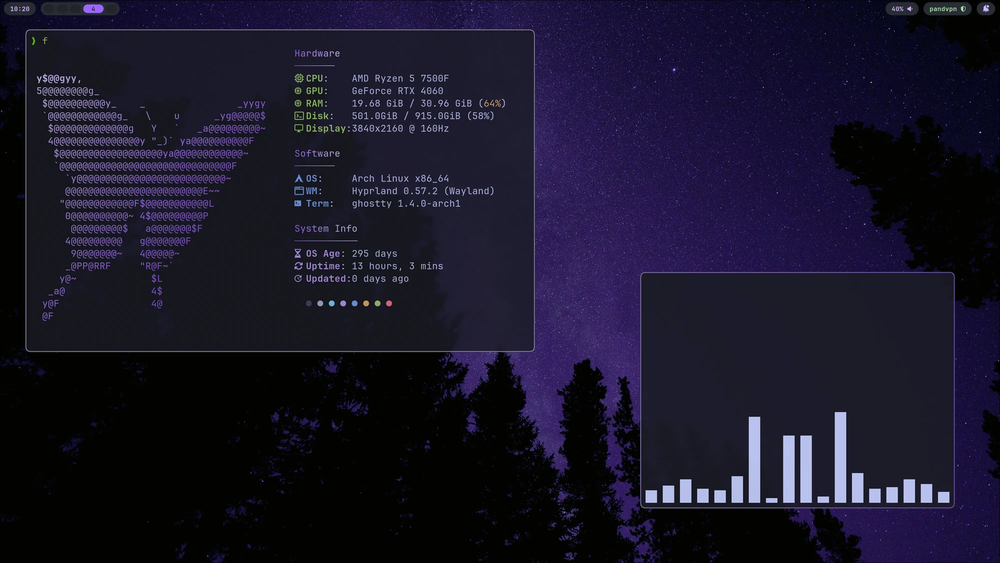
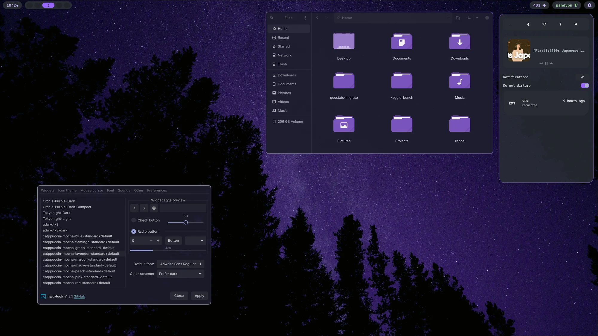
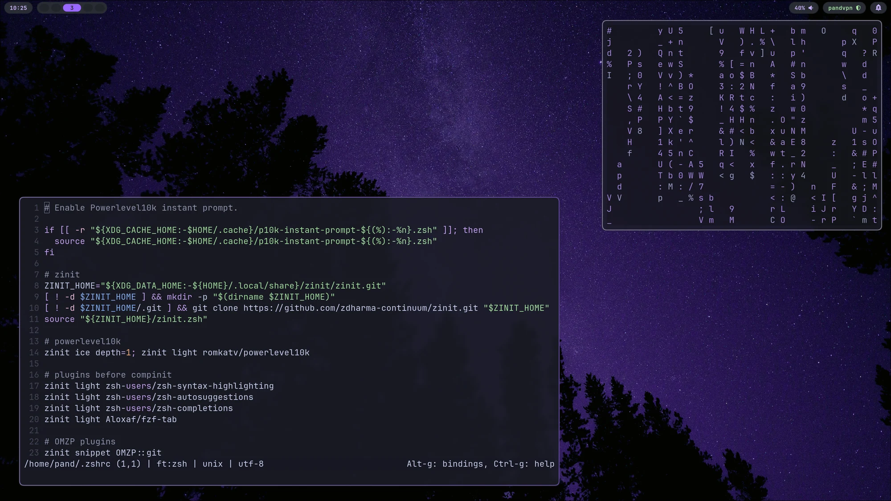
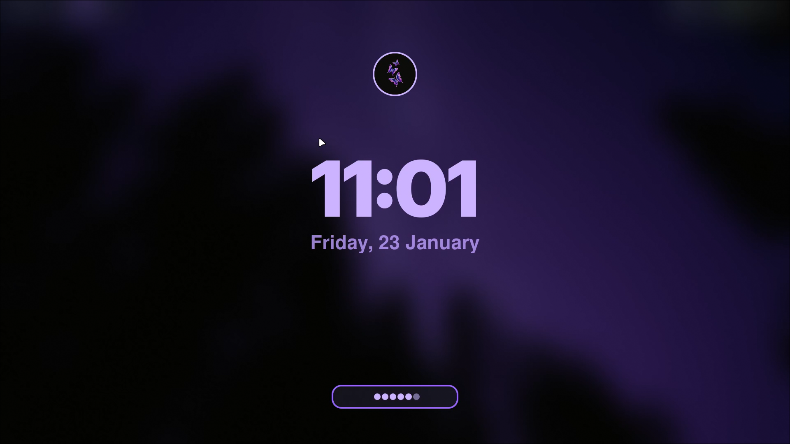
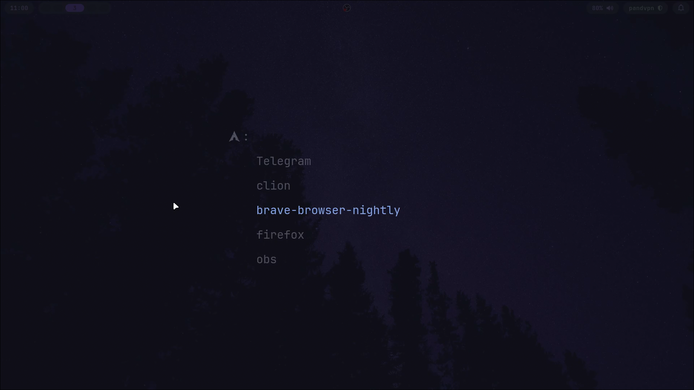
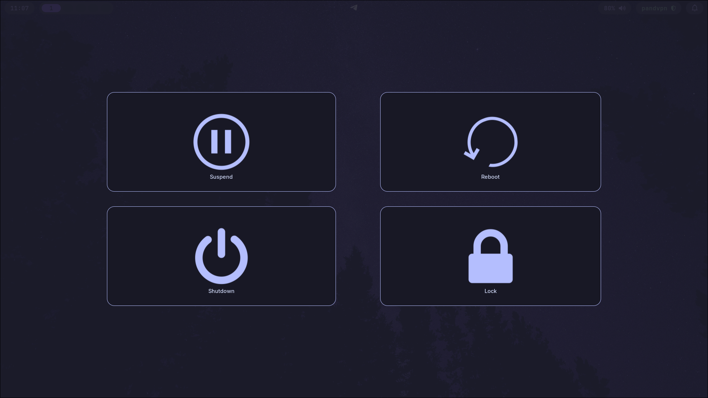

<div align="center">

# 🌌 Hyprdots

**Minimal purple-themed Hyprland dotfiles**



<br>


</div>

---

## 🖼 Gallery

<table>
  <tr>
    <td width="50%"><br><sub>🖥 <b>Terminal</b> — ghostty + fastfetch</sub></td>
    <td width="50%"><br><sub>🔔 <b>Notification center</b> — SwayNC + Waybar VPN widget</sub></td>
  </tr>
  <tr>
    <td colspan="2"><br><sub>📝 <b>Editor</b> — micro</sub></td>
  </tr>
</table>

<table>
  <tr>
    <td width="33%"><br><sub>🔒 <b>hyprlock</b></sub></td>
    <td width="33%"><br><sub>🔍 <b>tofi</b> launcher</sub></td>
    <td width="33%"><br><sub>⏻ <b>wlogout</b></sub></td>
  </tr>
</table>

## 🚀 Quick start

```bash
git clone https://github.com/dkorbelainen/hyprdots.git
cd hyprdots
chmod +x install.sh
./install.sh
```

`install.sh` symlinks configs into `~/.config`, links the Typora theme, sets Typora as default markdown editor and applies the GTK theme.

> [!NOTE]
> Install [dependencies](#-dependencies) first.

## 📦 Dependencies

<details>
<summary><b>Package list & install command</b></summary>

<br>

- **Core:** `hyprland`, `waybar`, `swaync`, `tofi`, `wlogout`
- **Daemons:** `hyprpaper`, `hypridle`, `hyprlock`
- **Tools:** `ghostty`, `fastfetch`, `micro`, `typora`, `jq`, `nwg-look`, `gpu-screen-recorder`
- **Audio/brightness:** `pipewire`/`wireplumber`, `pavucontrol`, `wpctl`, `brightnessctl`, `playerctl`
- **Screenshots:** `grim`, `slurp`, `wl-clipboard`, `imagemagick`
- **Networking:** `iproute2`
- **Notifications:** `libnotify` (`notify-send`)
- **Display manager (recommended):** SDDM with Astronaut theme

Arch-based distros:

```bash
sudo pacman -S hyprland waybar swaync hyprpaper hypridle hyprlock ghostty fastfetch micro jq pipewire wireplumber pavucontrol gpu-screen-recorder brightnessctl playerctl grim slurp wl-clipboard imagemagick iproute2 libnotify nwg-look zsh git tela-circle-icon-theme-purple ffmpegthumbnailer gst-libav gst-plugins-ugly
yay -S tofi wlogout typora bibata-cursor-theme catppuccin-gtk-theme-mocha sddm-astronaut-theme-git
chsh -s $(which zsh) # change your shell to zsh
source ~/.zshrc
```

</details>

## 🛠 Manual setup

<details>
<summary><b>Steps the scripts don't cover</b></summary>

<br>

- 🖥 **Monitor:** `hyprland.conf` uses `preferred` mode; set your own in `monitor=` (author: 4K 160Hz, scale 1.5, commented).
- 📝 **Typora theme:** pick *Themes → Catppuccin Mocha* once in Typora.
- 🎨 **SDDM theme (optional):** [Astronaut theme](https://github.com/Keyitdev/sddm-astronaut-theme)
- 🛡 **VPN widget:** `vpn-status.sh` / `vpn-toggle.sh` in `~/.config/waybar/scripts/` are placeholders built around a `hysteria-client.service` user unit. Put your own VPN start/stop/status logic there and change the `pandvpn` label.
- 🖼 **Wallpaper / 👤 hyprlock avatar (optional):** replace `.config/hypr/wallpaper.jpg` and `.config/hypr/avatar.png` with your own.
- 🥾 **rEFInd theme (optional):** `sudo EFI_ROOT=/boot/EFI ./install-refind.sh` copies the Catppuccin rEFInd config from `boot/EFI/refind`.

</details>

## 📜 Licenses & attributions

- Repo configs/scripts: MIT (see `LICENSE`).
- Catppuccin themes/icons: MIT.
- Wallpaper `.config/hypr/wallpaper.jpg`: photo by Joshua Woroniecki, [Unsplash License](https://unsplash.com/photos/the-night-sky-is-filled-with-stars-and-trees-1ByBY06L-Z0).
